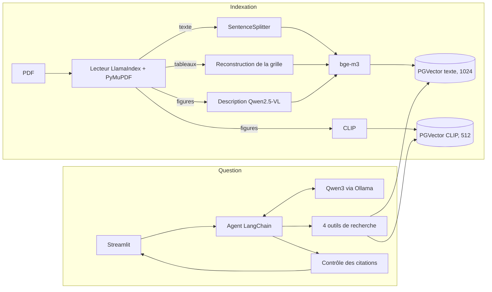

# MaintiDoc — Note technique, Partie I : RAG multimodal agentique

## 1. Périmètre

Application de questions-réponses sur un PDF contenant du texte, des tableaux et des images.
Les réponses sont rédigées en français et renvoient à des pages vérifiables. MaintiDoc ne pilote
aucun équipement et ne remplace pas un technicien habilité.

Document de démonstration : *Attention Is All You Need* (11 pages), recommandé par l'énoncé pour
démarrer. **Aucun manuel de maintenance n'a encore été testé.**

Le cadre suivi est l'énoncé « Activité — Partie I ». La feuille de route du projet décrit une
étape 1 différente (PyMuPDF, BGE-M3, Qdrant, FastAPI, 30 à 50 documents). Seuls PyMuPDF et
BGE-M3 sont communs aux deux. Qdrant, FastAPI, le corpus, l'OCR et les droits d'accès ne sont
pas réalisés ; ce point est à confirmer avec l'encadrant.

Hors périmètre : analyse d'une photographie envoyée par l'utilisateur, MCP, historique des
interventions, tickets, bot de messagerie.

## 2. Architecture

## 3. Modèles et outils

| Rôle | Choix | Raison |
|---|---|---|
| LLM et agent | `qwen3:8b` (Ollama, mode « réflexion » désactivé) | Poids ouverts, appel d'outils, tient sur un Mac 16 Go |
| Description d'images | `qwen2.5vl:3b` | Modèle vision léger exécutable en local |
| Embeddings texte | `bge-m3` (1024 dimensions) | Multilingue : questions en français, document en anglais |
| Embeddings image | `openai/clip-vit-base-patch32` (512) | Recherche texte vers image |
| Indexation | LlamaIndex : `BaseReader`, `SentenceSplitter`, `PGVectorStore` | Demandé par l'énoncé |
| Base vectorielle | PostgreSQL 17 + pgvector, index HNSW, distance cosinus | Demandé par l'énoncé |
| Orchestration | LangChain `create_agent` | Demandé par l'énoncé |
| Interface | Streamlit | Demandé par l'énoncé |

PyMuPDF est distribué sous licence AGPL (ou commerciale) : à vérifier avant toute diffusion du
produit.

## 4. Choix de conception

### 4.1 Extraction

LlamaIndex ne fournit pas, en local, l'extraction des tableaux et des figures (LlamaParse est un
service distant). Le lecteur est donc un `BaseReader` LlamaIndex construit sur PyMuPDF.

* **Tableaux.** La détection automatique de PyMuPDF localisait les 3 tableaux, mais fusionnait
  les lignes dans une cellule et transformait `10^19` en `1019`. La grille est reconstruite
  à partir de la position des caractères : exposants et indices, en-têtes sur plusieurs lignes,
  cellules fusionnées, libellés de groupe comme « (A) ». Les 3 tableaux ont été comparés
  visuellement au PDF et plusieurs valeurs sont vérifiées par des tests.
* **Format donné au LLM.** Avec la grille Markdown, le modèle a répondu « 64 têtes d'attention »
  au lieu de 8, en confondant deux colonnes. Chaque ligne est désormais indexée sous la forme
  `en-tête = valeur`. La grille sert à l'affichage.
* **Figures.** La figure 2 est composée de deux images. Les images partageant une légende sont
  regroupées et la zone est rendue depuis la page, avec ses titres vectoriels.
* **Découpage.** Texte découpé page par page (450 tokens, recouvrement 60), pour que la page
  citée soit exacte. Un tableau n'est jamais découpé.

### 4.2 Stockage

* `data_maintidoc_text` : passages, tableaux et descriptions de figures (26 lignes).
* `data_maintidoc_clip` : les 2 figures, encodées par CLIP.
* `maintidoc_documents` : registre des documents.

Métadonnées : `file_id` (empreinte du fichier), `source`, `page`, `type`, `ref`, `caption`,
chemins des images. Réindexer un fichier remplace ses lignes, sans doublon (vérifié).
`doc_id` est une clé réservée par LlamaIndex, écrasée à l'écriture : ce défaut, rencontré
pendant le développement, rendait toutes les recherches filtrées vides.

### 4.3 Recherche des images

Deux classements sont fusionnés par *reciprocal rank fusion* : les descriptions (bge-m3) et les
images elles-mêmes (CLIP). CLIP étant entraîné en anglais, l'agent lui fournit une requête en
anglais. L'apport propre de CLIP **n'est pas mesuré** : avec 2 figures, il n'y a rien de
significatif à comparer.

### 4.4 Orchestration agentique

Outils : `rechercher_texte`, `rechercher_tableaux`, `rechercher_figures`, `lire_page`. Chacun
est lié au document sélectionné ; le modèle ne peut pas en interroger un autre.

Le choix d'outil d'un modèle de 8 milliards de paramètres est irrégulier. Observé : réponse
« complexité constante » (fausse) pourtant accompagnée d'une citation, après une recherche dans
le texte seul, sans le tableau 1. Mesures prises :

* **contexte complémentaire** : le texte est accompagné du meilleur tableau, les tableaux de
  passages de texte, les figures du texte de leur page ;
* **repli** sur le RAG linéaire si aucune source n'est récupérée ;
* **limites** : 5 appels d'outils par question ;
* **gestion du contexte** : numérotation unique sans doublon, 3 derniers échanges conservés sans
  leurs anciennes citations, 24 000 caractères de sources au maximum. Une source non transmise
  au modèle ne peut pas être citée ;
* **questions de suivi** : le repli et le RAG simple recherchent aussi avec la question
  précédente (défaut trouvé en testant l'interface avec « Et en anglais-français ? »).

### 4.5 Citations et sécurité

Le programme vérifie que chaque `[Sx]` cité correspond à une source réellement récupérée et
signale les réponses sans citation. **Il ne vérifie pas que la source prouve l'affirmation** :
l'interface permet donc d'ouvrir la page d'origine.

La consigne traite le contenu des documents comme des données et non comme des instructions.
Aucun test d'injection de prompt n'a été mené. L'application n'a pas d'authentification et
écoute uniquement sur la machine locale.

## 5. Évaluation

Détail complet et réponses intégrales : [`resultats_evaluation.md`](resultats_evaluation.md).

| Jeu de questions | Agent | RAG simple |
|---|---|---|
| Réglage (7, dont 1 hors document) | 7/7 | 7/7 |
| Contrôle (5, dont 1 hors document) | 5/5 | 5/5 |

Comment lire ces chiffres :

* le contrôle automatique vérifie la présence des valeurs attendues et la page citée (ou le
  refus). Une réponse « réussie » peut contenir d'autres erreurs ;
* le jeu de réglage a servi à ajuster le système. Avant les derniers ajustements, l'agent a
  obtenu 6/7 puis 5/7, avec des échecs sur des questions différentes ;
* le jeu de contrôle n'a pas servi au réglage, mais il est petit, rédigé par le développeur et
  porte sur le même document. Ses questions factuelles sont simples ;
* une modification de modèle, de consigne ou de document peut changer ces résultats.

Durées observées sur Mac M4, 16 Go : agent 18 à 37 s par question, sauf la première du passage
final (205 s, cause non analysée) ; RAG simple 34 à 60 s. Indexation depuis l'interface : 70 s.

## 6. Exemples de questions et réponses observées

**Tableau.** « Quel score BLEU le Transformer (big) obtient-il en anglais-allemand et en
anglais-français ? »
> Le Transformer (big) obtient un score BLEU de 28.4 pour l'anglais-allemand et un score BLEU de
> 41.0 pour l'anglais-français [S1].

S1 : tableau 2, page 8. Correct.

**Formules dans un tableau.** « Quelle est la complexité par couche de la self-attention comparée
à une couche récurrente ? »
> La complexité par couche de la self-attention est de O(n² · d), tandis que celle d'une couche
> récurrente est de O(n · d²) [S5].

S5 : tableau 1, page 6. Correct.

**Texte.** « Quel optimiseur est utilisé et combien d'étapes de warmup sont prévues ? »
> L'optimiseur utilisé est l'Adam [S1]. Le nombre d'étapes de warmup prévues est de 4000 [S1].

S1 : page 7. Correct.

**Hors document.** « Quelle est la procédure de remplacement du roulement d'une pompe
centrifuge ? »
> Les documents indexés ne permettent pas de répondre à cette question.

**Exemple avec erreurs.** « Montre-moi le schéma de l'architecture du Transformer et décris ses
deux parties principales. » (agent, figure et texte de la page 3, contrôle « réussi »)

La réponse identifie bien l'encodeur et le décodeur, mais place l'encodage positionnel *avant*
l'embedding (c'est l'inverse) et ne précise pas que la première attention du décodeur est
**masquée**.

## 7. Limites

**Fidélité des réponses**
* Une citation valide n'est pas une preuve : le modèle peut mal interpréter la source citée.
* Les descriptions de `qwen2.5vl:3b` reprennent correctement une partie des libellés, mais se
  trompent sur les liaisons. Lors d'un essai dans l'interface sur la figure 2, la réponse a
  décrit le flux dans le désordre tout en citant la figure. **Pour un schéma électrique ou
  hydraulique, ce serait dangereux : la figure originale doit être consultée.**
* Les formulations françaises sont parfois maladroites ou fautives.

**Extraction**
* Les heuristiques ne sont validées que sur ce document. Un tableau sans filets, tourné, sur
  plusieurs pages ou à cellules multilignes peut être mal reconstruit.
* Les tableaux non détectés par PyMuPDF restent dans le texte courant, sans structure.
* Seules les figures contenant des images matricielles sont extraites : un schéma entièrement
  vectoriel est ignoré. C'est fréquent dans les manuels techniques.
* La légende est associée selon sa position (sous la figure) et les préfixes « Figure », « Fig. »,
  « Table » et « Tableau ».
* Les exposants ne sont restitués que dans les tableaux ; dans le texte courant, `10⁻⁹` devient
  `10−9`. Les formules sont mal linéarisées.
* Pas d'OCR : un PDF entièrement scanné est refusé, et les pages scannées d'un PDF mixte ne sont
  pas lues.

**Système**
* Un seul document est interrogé à la fois ; pas de reranker, de versions ni de droits d'accès.
* Latence de plusieurs dizaines de secondes, usage mono-utilisateur.
* La réindexation supprime puis réécrit sans transaction globale : après une interruption à ce
  moment précis, il faut réindexer.

## 8. Pistes pour la suite

1. Tester un vrai manuel de maintenance autorisé : schémas vectoriels, tableaux de codes défaut.
2. Ajouter l'OCR et l'extraction des figures vectorielles.
3. Constituer un jeu d'évaluation plus grand, relu par une personne, avant de comparer des
   modèles ou d'ajouter un reranker (étape 2).
4. Essayer un modèle vision plus grand pour les schémas.
